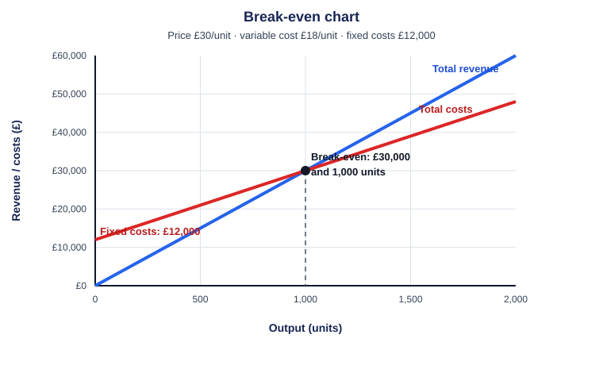

# Business Finance — checked teaching units (current specification)

**Batch status:** substantive teaching and practice for all 13 numbered finance clauses (3.1.1–3.5.3), including the listed nested specification points. The units below were checked against the current Pearson specification and named official practice/mark-scheme sources; all newly written questions are labelled constructed and unscored. This completes only the Finance batch, not the whole Business specification or historical bank.

**Current authority:** Pearson *International GCSE Business Specification*, Issue 2, February 2026, subject content §3 pp.14–15 and Appendix 4 formulae p.30. The exam provides its listed accounting formulae; students still need to understand inputs, method, interpretation and basic equations. Both papers can sample the whole spec; Paper 2 places this in large-business contexts.

**Source identity and SAM correction:** official 2016 Sample Assessment Materials (SAM), 4BS1/02 P2 question-paper section printed pp.35–50, P2 mark-scheme section pp.51–64. The 2016 SAM is a benchmark, not the current specification. Its P2-specific reviewed items include Q1(a)(v), markup (QP p.38); Q1(e), gross profit margin (QP p.39); and Q3(e), choosing between new shares and retained profits to fund product development (QP section pp.35–50; exact QP folio not confirmed in the extracted view; matching MS item is in the P2 MS section pp.51–64). These are P2 questions—not the similarly numbered P1 questions. The SAM was read via extracted text/searchable Pearson source material; it is not held locally and page images were not visually inspected, so cite exact wording from the PDF only after checking the original page.

The earlier figures **−200,000 Tks** and **15,500 Tks** are from **P1 Q1(a)(v–vi), QP printed p.8**, not P2. They are not used as P2 practice below. P1 Q1(a)(v): 1,200,000 + 1,400,000 − 2,800,000 = −200,000 Tks. P1 Q1(a)(vi): 20 × 620 = 12,400 rupees; 12,400 ÷ 0.8 rupees per Tks = 15,500 Tks. Correct arithmetic; wrong earlier paper attribution.

---

## 3.1.1 — Why a business needs finance

**Requirement (Pearson specification §3.1.1, printed p.14):** finance for short-term needs, long-term needs, starting up and expanding.

**Teach it.** Finance supplies cash to meet expenditure before or while the related receipts arrive. Short-term need is usually a temporary working-capital timing gap (for example, paying suppliers before customers pay); long-term finance supports assets/projects whose benefits extend over years (premises, equipment, product development). Start-up finance funds initial setup and early operations before stable receipts; expansion finance pays for increased capacity, premises, stock, systems or market entry. These labels describe *purpose and time horizon*, not an automatic best source: an overdraft can bridge timing; a long-lived asset should not normally depend on a continuously renewed overdraft. Forecast scale, timing, repayment capacity, cost and risk before choosing. A profitable plan can still fail if cash is unavailable at the due date.

**Practice — constructed, unscored.** A delivery start-up needs £8,000 for its first month’s wages and fuel while customers pay invoices 30 days later. Separately, an established retailer expanding into a new region needs £180,000 for a warehouse expected to serve it for ten years. Classify each need and give a financing-horizon reason.

**Answer / marking rationale.** Wages and fuel are a short-term working-capital need: payments fall due before invoice receipts, so the immediate gap is temporary. The warehouse is a long-term expansion/start-up asset need because it will provide capacity over many years; financing should broadly match that useful life and expected returns. Credit is for correctly distinguishing both uses and linking horizon/timing to the need—not merely naming a source. No invented mark score.

**Checked record / anchors.** Specification §3.1.1, printed p.14; SAM P2 Q3(e), in the P2 QP section pp.35–50 (the specific QP folio was not confirmed in the extracted view), sets an applied product-development funding choice; Pearson’s *Getting Started Guide*, printed p.43, reproduces the item and guidance. It does not cover every financing horizon. Constructed practice checked against the distinction between short and long-term need; no official score claimed.

## 3.1.2 — Internal sources of finance

**Requirement (Pearson specification §3.1.2, printed p.14):** personal savings, retained profit, sale of assets.

**Teach it.** Internal finance comes from the owner/business rather than a new outside lender or investor. Personal savings are owner funds introduced at start-up, common for an unincorporated start-up; the amount is limited by personal wealth and is at risk. Retained profit is profit kept in the business rather than distributed; it avoids contractual interest and a new outside owner but is available only if the business has generated profit and retained cash. Accounting profit is not automatically cash. Selling assets converts an existing resource into cash; selling idle/unneeded assets can release funds without new debt, but selling productive assets can reduce capacity and future income. “Internal” identifies origin, not zero cost: using retained profit or an asset has an opportunity cost.

**Practice — constructed, unscored.** A furniture company needs £60,000 for a new cutting machine. It has £25,000 retained profit in cash, an unused van worth £8,000, and its founder can invest £10,000. Is internal finance alone enough? Recommend a sensible use of these funds and state one drawback.

**Answer / marking rationale.** Together the stated sources could raise £43,000 (£25,000 + £8,000 + £10,000), leaving £17,000 to find elsewhere; they cannot by themselves meet £60,000. Use cash retained profit, consider selling the unused van if it is genuinely unnecessary, and use the founder’s savings only if the owner accepts personal risk. Explain opportunity cost/limited availability. Credit the arithmetic, all three source classifications and a contextual limitation; do not assume retained accounting profit equals spendable cash.

**Checked record / anchors.** Specification §3.1.2, p.14 lists exactly these three internal sources. SAM P2 Q3(e), in QP section pp.35–50 (specific QP folio not confirmed in the extracted view), contrasts retained profit with new share capital; Pearson’s *Getting Started Guide* p.43 reproduces the item/guidance. It does not test personal savings or asset sales. Constructed practice and £43,000/£17,000 reconciliation checked; unscored.

## 3.1.3 — External sources of finance

**Requirement (Pearson specification §3.1.3, printed p.14):** overdraft and trade payables; loan capital and share capital, including stock-market flotation by public limited companies; venture capital; crowdfunding.

**Teach it.** External funds come from another party. An overdraft lets a bank customer temporarily withdraw beyond its balance up to an agreed limit; it is flexible for short cash gaps but can be repayable on demand, variable-rate and expensive if used permanently. Trade payables/trade credit mean suppliers allow payment after delivery; this preserves cash temporarily but is short term, may forfeit a prompt-payment discount, and can damage supplier relations if late. Loan capital is borrowed for an agreed period and normally incurs interest and repayment obligations; it does not normally dilute ownership, but adds fixed commitments/security risk. Share capital exchanges ownership rights for investment; a public limited company can raise shares by flotation on a stock market, but issue costs, disclosure and dilution of existing ownership/control matter. Venture capital is investment from specialist investors, often for higher-growth businesses; it may bring expertise/network as well as money, in return for an ownership stake and influence. Crowdfunding raises funds from many people through a platform; success is uncertain and campaigns can require fees, effort, delivery promises or equity/reward obligations. Match source to amount, duration, risk, control, cost, stage and repayment ability.

**Practice — constructed, unscored.** Choose a likely source for each: (A) a brief two-week delay before a large customer pays; (B) a PLC needs £30m for a ten-year capacity expansion and its owners accept some dilution; (C) a young technology firm needs growth capital and welcomes specialist guidance; (D) a café needs a small amount from many supporters to test a new community product; (E) a retailer needs stock now and its supplier offers 30-day terms; (F) a mature firm with predictable cash flow needs a long-term machine and its owners want to retain control. Give one reason and one caution for two choices.

**Answer / marking rationale.** A: overdraft for short timing gap (caution: not a permanent funding source; interest/recall risk). B: for a PLC, a share issue/flotation may suit a large long-term investment and avoids scheduled loan repayments (caution: ownership/control dilution, disclosure and flotation requirements). C: venture capital suits growth plus expertise (caution: investor stake/influence). D: crowdfunding (caution: target may not be reached and campaign/platform obligations). E: trade payables (caution: payment is still due and supplier relationship/discount may be affected). For a mature firm with predictable cash flow and owners who want to retain control, a term loan is a plausible alternative to issuing shares, but interest and repayments increase risk. Credit accurate matching plus contextual reasoning; alternative sources can be justified where facts permit. No constructed score.

**Official practice cross-check.** May 2023 4BS1/02 Q1(a)(ii), QP p.3, asks for an advantage of venture capital; the matching MS is P2 MS PDF p.4 and identifies expert advice. Q3(a), QP p.13, defines an overdraft; MS PDF p.16 accepts an agreement to draw more from the bank account than it contains. SAM P2 Q3(e), in QP section pp.35–50 (specific QP folio not confirmed in the extracted view), asks which of new shares or retained profits to use for product development; Pearson’s *Getting Started Guide* p.43 reproduces the prompt and AO guidance. The P2 MS section is pp.51–64. These sources check only some listed external sources; the constructed exercise covers remaining sources. Neither sampled source establishes a candidate mark.

## 3.2.1 — Why cash matters; cash is not profit

**Requirement (Pearson specification §3.2.1, printed p.14):** cash pays suppliers, overheads and employees; helps prevent insolvency; distinguish cash from profit.

**Teach it.** Cash is money available now. Businesses need it to settle wages, rent/other overheads, suppliers and debts when due. Inability to pay debts as they fall due can create insolvency and threaten survival even when sales and accounting profit look healthy. Profit is revenue less relevant costs over an accounting period; it may include credit sales not yet collected and non-cash expenses, so profit is not the bank balance. Conversely, borrowing can increase cash without being revenue/profit, and buying equipment may reduce cash before the cost is fully recorded as an expense. Cash management and profitability are related but answer different questions.

**Practice — constructed, unscored.** A wholesaler sells £40,000 of goods on 60-day credit and records £9,000 accounting profit this month. Its suppliers require £18,000 in cash next week; only £6,000 is in the bank and no overdraft is agreed. Explain the immediate risk, using the figures, and why the reported profit does not remove it.

**Answer / marking rationale.** There is a £12,000 immediate cash shortfall (£18,000 due − £6,000 available). The £40,000 credit sales may be included in revenue/profit but are not yet cash; the firm may be unable to pay suppliers when due, risking insolvency/supply interruption despite positive accounting profit. Credit calculation, cash/profit distinction and linked consequence. A forecast or credit-control action could help, but does not turn the unpaid invoice into cash now.

**Official practice and checked answer.** May 2023 P2 Q2(c), QP p.9, asks why cash-flow forecasting is important; MS p.11 permits anticipating inflows/outflows, spotting insufficient funds and planning adjustments, and says a definition alone earns no marks. ER pp.26–28 discusses a 3-mark candidate answer. This tests the usefulness of forecasts, not every cash/profit distinction. The constructed answer’s £12,000 gap was recalculated.

## 3.2.2 — Calculate and interpret a cash-flow forecast

**Requirement (Pearson specification §3.2.2, printed p.14):** cash inflows, cash outflows, net cash flow, opening and closing balances.

**Teach it.** A cash-flow forecast predicts cash receipts and payments over future periods. Inflows are cash received (e.g. customer receipts, loan proceeds); outflows are cash paid (e.g. suppliers, wages, rent). Net cash flow for a period = total inflows − total outflows; closing balance = opening balance + net cash flow, and becomes next period’s opening balance. A positive net flow does not guarantee a positive closing balance; a negative net flow can be manageable if opening cash is sufficient, though repeated deficits need action. Forecasts are estimates and depend on timing/accuracy. Borrowing is a cash inflow but not sales revenue; credit sales enter the forecast when cash is expected, not just when invoiced.

**Practice — constructed, unscored; all values in £ for April.** Opening cash £5,000. Expected customer receipts £6,800 and a bank loan drawdown £2,000. Supplier payments £4,200, wages £1,600, rent £500. Calculate total inflows, total outflows, net cash flow and closing balance. State one implication.

**Answer / arithmetic check.** Total inflows = £6,800 + £2,000 = **£8,800**. Total outflows = £4,200 + £1,600 + £500 = **£6,300**. Net cash flow = £8,800 − £6,300 = **+£2,500**. Closing balance = £5,000 + £2,500 = **£7,500**. Carry £7,500 forward as May opening balance if no other adjustment. The loan is cash received, not revenue or profit. Rationale: marks/credit should distinguish flows from balances and show the sign and £ units; do not add opening cash into net cash flow.

**Checked record / source decision.** Specification §3.2.2, p.14. May 2023 P2 Q2(c) (above) is official forecast-importance practice but does not ask for the four calculations. The often-repeated −200,000 Tks closing balance belongs to **P1** SAM Q1(a)(v), QP p.8, not P2. No suitable P2 cash-flow-table calculation was established in the reviewed P2 sample; this is deliberately constructed and unscored. All additions/subtractions and balances were recalculated.

## 3.3.1 — Revenue, costs, profit and loss

**Requirement (Pearson specification §3.3.1, printed p.14):** concepts/calculations of revenue, fixed and variable costs, total costs, profit and loss.

**Teach it.** Revenue is sales income: selling price × quantity sold. Fixed costs do not vary directly with output over the relevant range/time (e.g. monthly rent); variable costs change with output (e.g. material cost per item × units). Total costs = total fixed costs + total variable costs. Profit = revenue − total costs; a negative result is a loss. “Fixed” does not mean never changes: rent can change when a lease renews, and step-fixed costs may rise when capacity thresholds are crossed. Do not confuse variable cost per unit with total variable cost.

**Practice — constructed, unscored.** A large bakery sells 500 boxes at £18 each. Total fixed costs for the month are £2,500; variable cost is £6 per box. Calculate revenue, variable costs, total costs and profit/loss. Include units. As a check, calculate the result if only 100 boxes sell at the same price/costs.

**Answer / recalculation.** Revenue = 500 × £18 = **£9,000**. Variable costs = 500 × £6 = **£3,000**. Total costs = £2,500 + £3,000 = **£5,500**. Profit = £9,000 − £5,500 = **£3,500 profit** (not £3,500 per unit). At 100 boxes, revenue = £1,800, variable costs = £600, total costs = £3,100, so £1,800−£3,100 = **−£1,300**, i.e. a £1,300 loss. Rationale: distinguish per-unit from total variable cost; show each step, recognise a negative profit as a loss, and label pounds. No score assigned.

**Official P2 link and review.** May 2023 P2 Q1(a)(vi), QP p.5, tests that revenue and total costs are equal at break-even, which depends on these concepts; MS PDF p.5 gives D. It does not provide a full revenue/cost/profit computation, so the arithmetic exercise is constructed. Specification §3.3.1, p.14.

## 3.3.2 — Break-even concept and calculation

**Requirement (Pearson specification §3.3.2, printed p.14):** break-even output from a formula or diagram.

**Teach it.** Break-even is the output at which total revenue equals total costs; profit is zero there. Contribution per unit = selling price − variable cost per unit. Break-even output = total fixed costs ÷ contribution per unit. Units must be whole units in a physical-output problem (if the result is fractional, round up to the next unit to reach or exceed break-even). In a diagram, locate the intersection of total-revenue and total-cost lines, then read its output from the horizontal axis. Do not treat fixed costs crossing revenue as break-even: variable costs are included in total costs.

**Labelled chart — constructed for this unit:** fixed costs £12,000; selling price £30/unit; variable cost £18/unit. The axes are output (units) and revenue/costs (£); blue is total revenue, red is total costs; the dotted guide reads the break-even output.

**Practice — constructed, unscored.** (a) Calculate break-even output from the figures above. (b) Read the graph: state the fixed-cost intercept; read the break-even output and money value; at 1,500 units, read total revenue and total costs and calculate the profit/loss. (c) Explain why the fixed-cost line alone does not define break-even.

**Answer / recalculation.** (a) Contribution = £30 − £18 = **£12 per unit**. Break-even = £12,000 ÷ £12/unit = **1,000 units**. (b) Fixed-cost intercept = **£12,000**. Break-even is **1,000 units, £30,000**. At 1,500 units, revenue = 1,500×£30 = **£45,000**; total costs = £12,000 + (1,500×£18) = **£39,000**; profit = **£6,000**. (c) Fixed costs do not include variable costs; only where total revenue meets total costs is profit zero. Units cancel correctly: pounds ÷ pounds per unit = units. Rationale: read each line at the same output and subtract total costs from revenue. No invented official mark.

**Official practice and checked answer.** May 2023 P2 Q1(a)(vi), QP p.5/MS PDF p.5, asks what is equal at break-even on a graph; official answer is total costs and revenue. It is an identity/interpretation item, not the calculation method, so the calculation above is constructed and unscored. Specification §3.3.2, p.14.

## 3.3.3 — Interpret break-even charts; changes and limitations

**Requirement (Pearson specification §3.3.3, printed p.14):** interpret effects of revenue/cost changes and limitations of break-even charts.

**Teach it.** On a standard chart, output is horizontal; money values are vertical. A higher selling price steepens/raises total revenue for a given output, increasing contribution and—if other assumptions hold—lowering break-even output. A higher variable cost per unit steepens total costs, reduces contribution and raises break-even output. Higher fixed costs raise the total-cost line and increase break-even. A chart simplifies reality: it often assumes constant selling price and unit variable cost, fixed costs within a relevant range, all output sold, one product or stable product mix, and known values. Demand may fall after a price rise; capacity, quality, waste and uncertainty may alter costs. Break-even is a planning aid, not a guaranteed forecast.

**Practice — constructed, unscored interpretation/evaluation.** Use the chart in §3.3.2 (fixed £12,000, price £30, variable £18, BE 1,000 units). (i) Recalculate BE if price rises to £33 and all else stays constant; describe how the total-revenue line changes. (ii) Recalculate if instead variable cost rises to £20; describe how the total-cost line changes. (iii) Recalculate if fixed costs rise to £15,000 while price and variable cost stay unchanged; describe the graph shift and new intersection. (iv) Advise whether a price rise is certain to reduce actual risk of loss.

**Answer / recalculation and graph-reading rationale.** (i) Contribution = £33−£18=£15; £12,000÷£15=**800 units**. At each output the revenue line is steeper/higher; the new intersection moves left, assuming demand and all other costs unchanged. (ii) Contribution = £30−£20=£10; £12,000÷£10=**1,200 units**. The total-cost line becomes steeper while its £12,000 intercept stays fixed; the intersection moves right. (iii) Contribution remains £12; £15,000÷£12=**1,250 units**. The total-cost line shifts vertically up by £3,000 in the relevant range (same variable-cost slope); the revenue line stays put and the intersection moves right. (iv) Not certain: the model gives a lower BE at unchanged sales/costs, but a higher price may reduce demand; if sales fall below 800 units, the price change may not improve the outcome. Check demand, capacity and other costs. Credit correct line movement, arithmetic and qualified interpretation; no official score claimed.

**Checked record / anchor.** Current spec §3.3.3 p.14. The May 2023 P2 Q1(a)(vi) item checks the graph’s equality at break-even only; it does not check cost/revenue shifts or limitations. This constructed exercise intentionally supplies the missing practice and was recalculated. Do not attribute the older P1 SAM Q2(f) break-even option choice to P2.

## 3.4.1 — Statement of comprehensive income

**Requirement (Pearson specification §3.4.1, printed p.15):** purpose and main features (sales, cost of sales, gross profit, expenses, operating profit); use in decisions; nature/importance of profit. Learners are **not required to construct** an income statement.

**Teach it.** A statement of comprehensive income summarises financial performance over a period. Sales/revenue less cost of sales gives gross profit; subtract other operating expenses to obtain operating profit. Gross profit indicates what remains from sales after the direct cost of goods/services sold; operating profit reflects operating expenses as well. Profit is revenue exceeding costs for the period and rewards business risk; retained profit can finance future activity, but accounting profit is not identical to cash. Managers can compare periods, investigate cost/revenue changes and decide whether to change prices, product range or expenses. Context and other evidence matter: one period or one profit figure alone does not prove overall success. The exam requires interpretation, not construction of the statement.

**Practice — constructed, unscored.** A firm reports (£000) sales 300; cost of sales 180; other operating expenses 75. Last year sales were 280, cost of sales 168 and operating expenses 67. Calculate both years’ gross and operating profit; explain one decision-relevant observation and why profit matters to an owner/business.

**Answer / arithmetic check.** Current gross profit = 300−180 = **£120k**; operating profit = 120−75 = **£45k**. Prior gross profit = 280−168 = **£112k**; operating profit = 112−67 = **£45k**. Revenue and gross profit increased in value, but operating profit was unchanged because expenses rose from £67k to £75k; the revenue figures alone do not establish an increase in units sold or customer demand. A manager should investigate the expense increase and whether the higher revenue value reflects more units, higher prices or a changed product mix—and whether it generated enough operating profit—before deciding to expand. Profit matters as a reward for entrepreneurial risk; retained profit may finance investment only to the extent that cash is actually available. Accounting profit is not the same as cash. Rationale: formula flow, comparison and nature/importance; no constructed income statement demanded from the learner.

**Official practice and checked answer.** May 2023 4BS1/02 Q4(b), QP p.18, asks why IKEA uses statements of comprehensive income to assess performance; MS PDF p.22 allocates AO2/AO3 and suggests comparing profit after new beds or checking whether employee-bonus costs were covered by increased production. ER pp.54–55 discusses a candidate response, not a universal marking rule. This is source-matched analysis practice. Specification §3.4.1 p.15.

## 3.4.2 — Statement of financial position

**Requirement (Pearson specification §3.4.2, printed p.15):** purpose and main features—current/non-current assets, current/non-current liabilities, capital employed—and interpretation; learners are **not required to construct** the statement.

**Teach it.** The statement of financial position is a snapshot at a date, unlike an income statement’s period. Assets are resources controlled: current assets are expected to be realised/used within the operating cycle or short term (e.g. cash, receivables, inventory); non-current assets support operations longer term (e.g. premises/equipment). Liabilities are obligations: current liabilities fall due soon (e.g. trade payables/short-term borrowing); non-current liabilities are due later (e.g. long-term loans). Capital employed represents long-term capital committed to the business; in a balanced simplified statement it can be expressed as equity plus non-current liabilities, equivalently total assets less current liabilities. Treat classifications and date carefully. A high asset figure is not automatically good: assets may be illiquid, obsolete or financed by debt. No statement construction is required by the specification; interpret a supplied extract.

**Practice — constructed, unscored.** At 31 March a company has cash £8k, receivables £12k, inventory £10k, equipment £50k, current liabilities £20k, non-current loan £30k, and equity £30k. Classify each item; calculate total current assets, total assets and capital employed; state one interpretation caution.

**Answer / recalculation.** Current assets = 8+12+10 = **£30k**. Non-current asset = equipment **£50k**. Total assets = **£80k**. Current liabilities = **£20k**; non-current liability = **£30k**; equity = **£30k**. Balance: £80k assets = £20k current liabilities + £30k non-current loan + £30k equity. Capital employed = equity + non-current loan = **£60k**, also total assets − current liabilities = £80k−£20k = £60k. Caution: £30k current assets do not all represent cash immediately available; £10k is inventory and receivables may not yet be collected. Rationale: classify current/non-current, verify balance, interpret liquidity carefully. No score assigned.

**Checked record / anchors.** Specification §3.4.2 p.15 explicitly excludes construction. Appendix 4 p.30 gives the qualification formulae, but this practice uses the standard capital-employed identity for interpretation. No suitable P2 sample item specifically on interpreting a position statement was verified in this batch; this is constructed/unscored. Arithmetic and balance were checked.

## 3.5.1 — Calculate and analyse six accounting ratios

**Requirement (Pearson specification §3.5.1, printed p.15):** gross profit margin; operating profit margin; markup; ROCE; current ratio; acid test ratio. Pearson’s specified formulae are provided in the examination (Appendix 4, p.30).

**Teach it.** Margins express profit as a share of revenue; markup expresses profit as a share of cost, so do not use the same denominator. For a £100 selling price and £60 cost, profit is £40: markup = £40/£60×100 = 66.67%, whereas gross profit margin = £40/£100×100 = 40%. Cost-plus pricing normally adds a chosen markup to unit cost; it does not add a profit-margin percentage to cost. ROCE relates operating profit to capital employed and indicates return on long-term funds invested. Current and acid-test ratios compare short-term assets to current liabilities; acid test removes inventory because inventory may not convert quickly to cash. A positive GPM is before other operating expenses; it neither proves positive operating/net profit nor shows cash available for investment. Profitability percentages and liquidity ratios answer different questions; compare over time/with similar businesses and explain business-specific causes rather than declaring a ratio universally “good.”

**Practice — constructed, unscored.** A firm has revenue £300,000; cost of sales £180,000; other operating expenses £75,000; selling price £100/unit; cost £60/unit; capital employed £225,000; current assets £90,000 including inventory £30,000; current liabilities £60,000. Calculate all six ratios, identify what each denominator is, and interpret one profitability and one liquidity result.

**Answer / independent recalculation.**

| Ratio | Work | Answer |
|---|---|---|
| Gross profit margin | (300,000−180,000) ÷ 300,000 × 100 | **40%** |
| Operating profit margin | (120,000−75,000) ÷ 300,000 × 100 | **15%** |
| Markup | (100−60) ÷ 60 × 100 | **66.67%** |
| ROCE | 45,000 ÷ 225,000 × 100 | **20%** |
| Current ratio | 90,000 ÷ 60,000 | **1.5:1** |
| Acid test ratio | (90,000−30,000) ÷ 60,000 | **1.0:1** |

All currency values are pounds; pounds cancel in ratios. Profit per unit is £40 and cost per unit £60, so markup is based on cost and rounds to 66.67% (to 2 d.p. for this constructed question); the same £40 profit is a 40% margin on the £100 selling price. GPM and OPM/ROCE are percentages; liquidity ratios are expressed as “:1” or a decimal, not as a percentage. Interpretation: the firm earns £0.40 gross profit from each £1 of revenue and £0.15 operating profit per revenue pound. Its current ratio is 1.5:1; after excluding £30k inventory, quick assets are £60k against £60k current liabilities, so acid test is 1.0:1. Neither ratio proves ability/inability to pay on time; compare timing and asset quality. A positive GPM alone says nothing conclusive about cash available for investment. Credit correct formula, substitution, denominators, sensible format and cautious interpretation; no constructed score.

**Official practice and checked answer.** May 2023 P2 Q1(e), QP p.6/MS p.7, asks gross profit margin to 2 d.p.: gross profit €11,725 ÷ revenue €37,368 ×100 = 31.377…%, rounded **31.38%**. The MS awards a method mark for substitution and a result mark; it accepts the correct numerical result without working. The calculation was independently repeated. SAM P2 Q1(e), QP p.39, is another gross-margin calculation, using iPhone selling price US$800 and cost of sales US$200: GP margin = 600/800×100 = **75%** (check exact values against the official page before quoting). SAM P2 Q1(a)(v), QP p.38, tests a 200% markup item. The P1 SAM closing cash balance/currency examples are not these P2 items. Specification §3.5.1 p.15; formulae p.30.

## 3.5.2 — Liquidity and comparisons

**Requirement (Pearson specification §3.5.2, printed p.15):** concept/importance of liquidity; compare with previous years and/or other organisations.

**Teach it.** Liquidity is the ability to meet current liabilities as they fall due. Current ratio includes inventory; acid test excludes it. Compare the business with itself across years and/or similar organisations, using consistent accounting periods and business models. A fall in either ratio may signal less cover, but the cause matters: expansion, seasonal timing, a deliberate inventory reduction or improved cash collection can alter the figure. A very high ratio is not automatically efficient if cash or inventory is idle. Ratios use a date’s balances and cannot show exact payment timing, asset quality, supplier terms or future inflows; use the wider evidence.

**Practice — constructed, unscored interpretation.** Company A’s current ratio changes from 1.8:1 to 1.5:1 and acid test from 1.4:1 to 1.0:1. Company B in the same sector has 1.6:1 and 0.9:1. Interpret A’s position without overclaiming.

**Answer / rationale.** A’s liquidity cover weakened year-on-year: current assets per £1 of current liabilities fell from £1.80 to £1.50; liquid current assets excluding inventory fell from £1.40 to £1.00. Against B, A’s current ratio **1.5:1 is below 1.6:1**, while A’s acid test **1.0:1 is above 0.9:1**. Thus A has slightly less total current-asset cover but slightly more cover once inventory is excluded; neither pair proves which business can pay every debt on time. Check cash collection, liability timing, inventory convertibility, seasonality and why ratios changed before recommending action. Credit the two distinct cross-company comparisons and the qualification. No mark score.

**Checked record / anchor.** Specification §3.5.2 p.15. May 2023 P2 Q4(a) is a percentage change in inventory, not a liquidity-ratio comparison; it is **not** claimed as practice for this clause. The constructed ratios were checked for units and compared on like-for-like bases. No suitable official current-spec P2 liquidity-comparison item is claimed here.

## 3.5.3 — Use financial documents to assess performance and inform decisions

**Requirement (Pearson specification §3.5.3, printed p.15):** use financial documents to assess business performance and inform decisions.

**Teach it.** Do not read an income statement, position statement or ratios in isolation. A statement of comprehensive income shows performance over a period (sales, costs, profit); a statement of financial position shows resources and obligations at a date (assets, liabilities, capital employed). Ratios support comparisons but need context and valid, consistent figures. Link evidence to a decision: e.g. falling margin may prompt investigation of cost/price, while weak liquidity may justify delaying expansion or arranging working capital. State uncertainty and what further evidence is needed. A decision should consider objective, cash timing, risk, non-financial effects and whether a trend is temporary. Profitability is not the same as liquidity or overall success.

**Practice — constructed, unscored evaluation.** A multinational retailer has rising revenue and gross profit, unchanged operating profit because operating expenses rose, and a current ratio falling from 1.6:1 to 1.1:1. It proposes opening stores in a new country. Evaluate whether the accounts alone justify immediate expansion.

**Answer / rationale.** Revenue and gross profit rose, but revenue growth by itself does not establish increased demand or sales volume: it can reflect price, product mix, exchange rates or other factors. Unchanged operating profit suggests the rise in gross profit was offset by higher operating expenses. A current ratio of 1.1:1 gives less current-asset cover per £1 of current liabilities than 1.6:1, but does not establish cash available or inability to pay; inventory, receivables and payment timing matter. The accounts do not alone establish cause, country demand, investment return or financing terms. Investigate expense growth, a cash-flow forecast, market evidence and project costs, then stage/defer expansion if liquidity cannot support commitments; alternatively, proceed if forecasts show adequate cash and returns. Positive gross profit is before operating expenses and does not itself establish operating profit or cash available to invest. Credit use of both documents/trends, linked implications and conditional decision. This is an unscored constructed answer, not an examiner-marked script.

**Official practice and review.** May 2023 P2 Q4(b), QP p.18/MS PDF p.22, asks why IKEA uses statements of comprehensive income to assess performance; it is the official checked practice anchor for document-use reasoning (MS AO2/AO3). It does not assess a statement of financial position or require a universal rule to expand/defer. Those are deliberately covered in constructed practice. Specification §3.5.3 p.15; 3.4.1–3.4.2 p.15.

---

## Batch review record and coverage boundary

- Checked all 13 codes and nested points against the current specification: §3.1–3.3 printed p.14, §3.4–3.5 p.15, Appendix 4 p.30.
- Official P2 practice checked in identity-matched May 2023 4BS1/02 QP/MS: Q1(a)(ii) venture capital (QP p.3, MS PDF p.4); Q1(a)(iii) currency conversion (QP p.4, MS PDF p.4); Q1(a)(iv) markup (QP p.4, MS PDF p.5); Q1(a)(vi) break-even chart identity (QP p.5, MS PDF p.5); Q1(e) gross profit margin (QP p.6, MS p.7); Q2(c) cash-flow forecast importance (QP p.9, MS p.11); Q3(a) overdraft (QP p.13, MS p.16); Q4(a) percentage fall in inventory (QP p.17, MS p.21; not itself a ratio); Q4(b) income statement use (QP p.18, MS p.22). The reviewed QP/MS files identify P72953RA and May 2023 4BS1/02. The May 2023 sources provide sample anchors, not complete specification coverage.
- Corrected the 2016 SAM P1/P2 contamination: P1 Q1(a)(v–vi), QP p.8, contains −200,000 Tks and 15,500 Tks. P2 examples are distinct: markup and GPM in P2 Q1, and funding choice in P2 Q3(e), with the exact P2 page anchors above. Do not claim the P1 cash-flow/exchange questions as P2.
- Constructed exercises are clearly labelled and not assigned Pearson scores. Each arithmetic example above was recomputed; ratios/percentages carry explicit denominators and units/rounding. Source-derived mark rationale is labelled only for the identified official questions.
- This Finance batch does not finish the other four specification sections, the rest of the answer bank, 2020 identity resolution, or the full historical archive review. Do not change the overall completion verdict on the basis of this batch alone.
